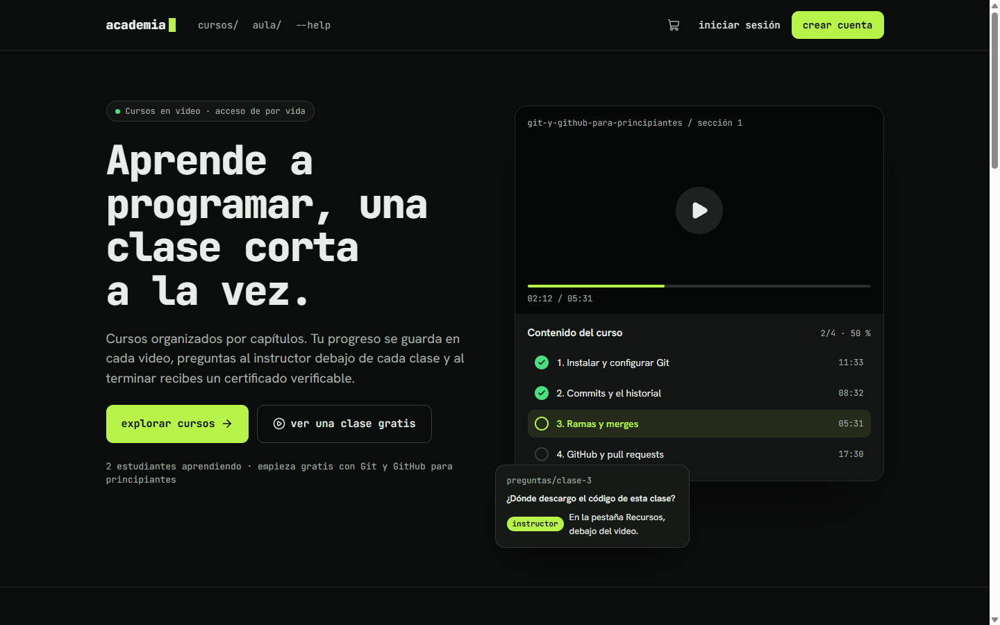
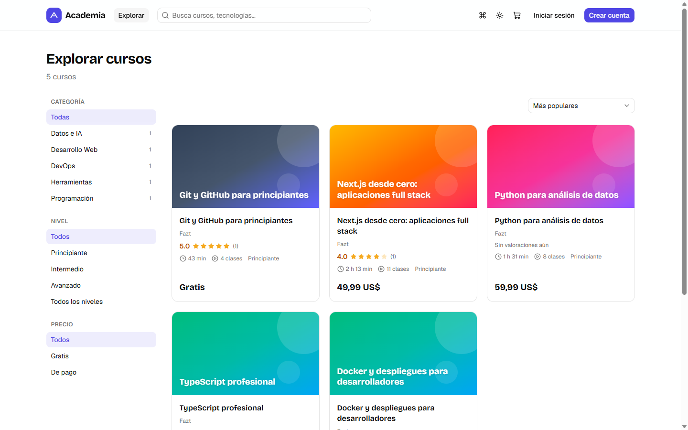
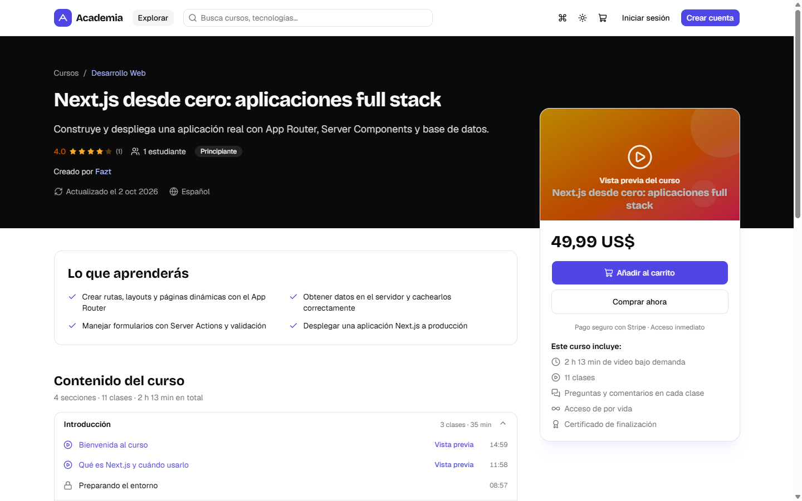
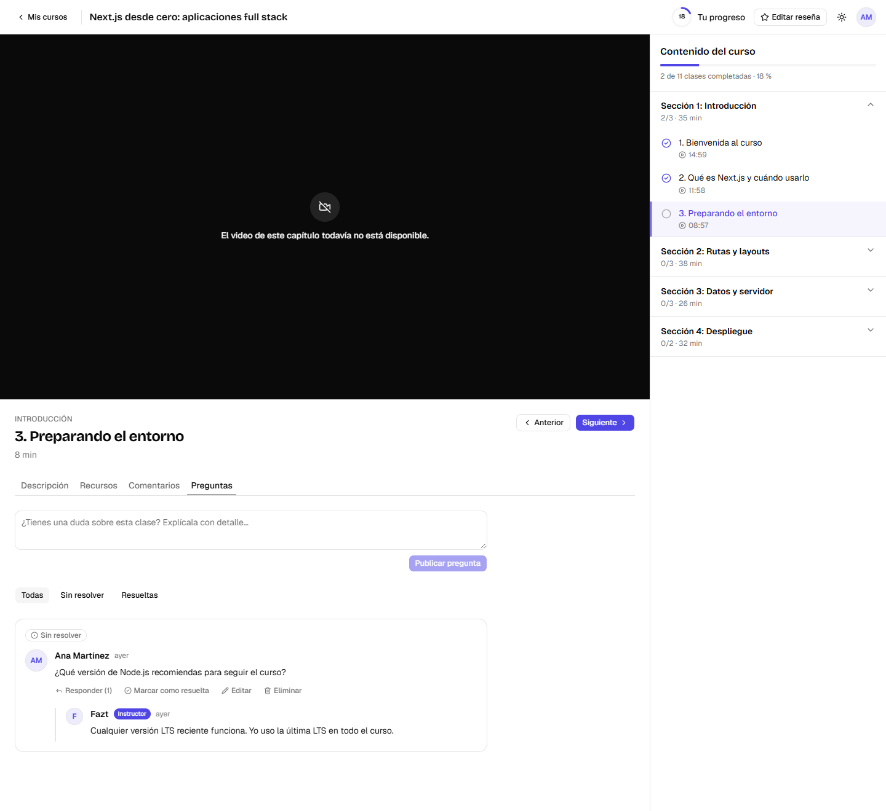
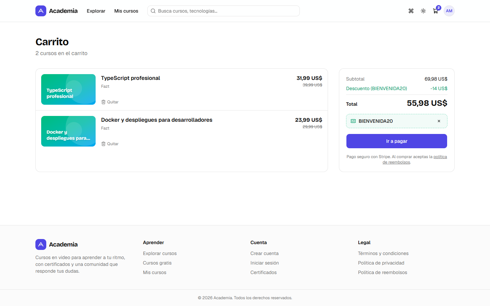
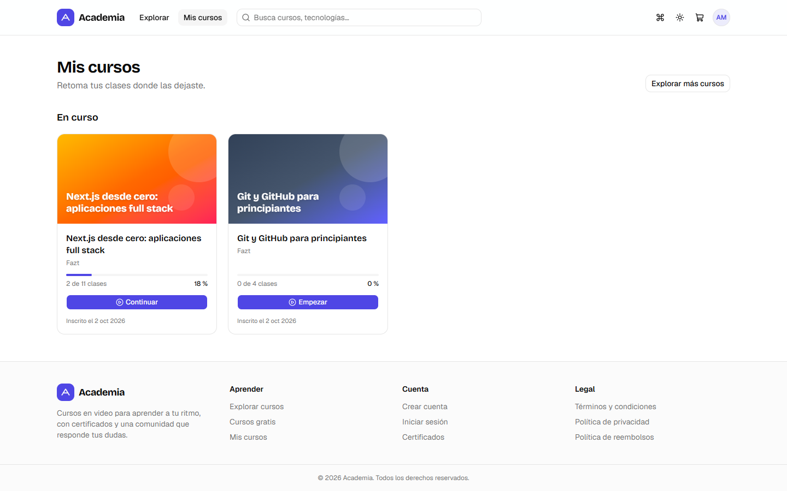
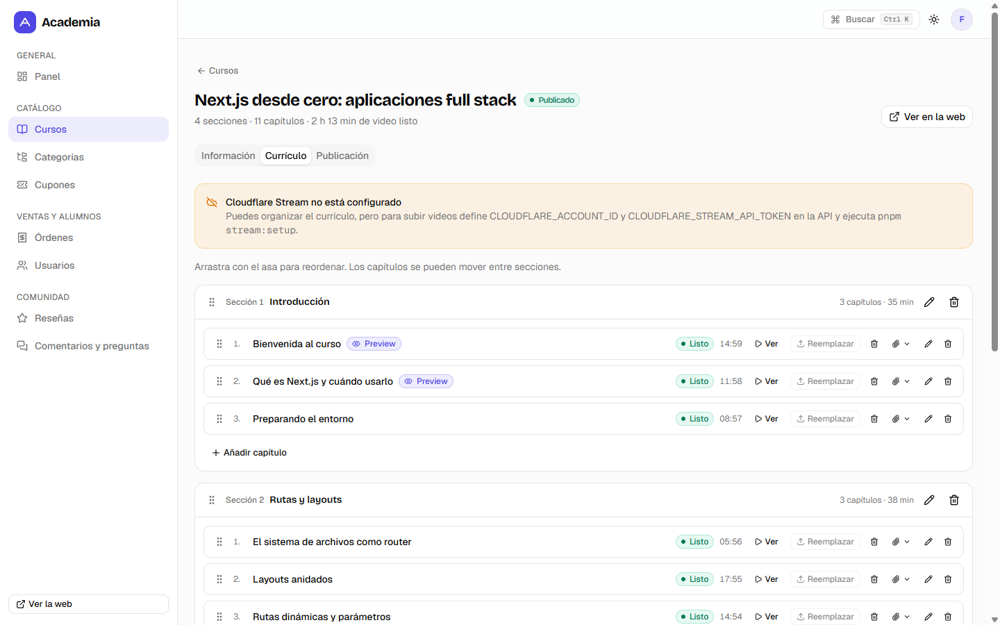
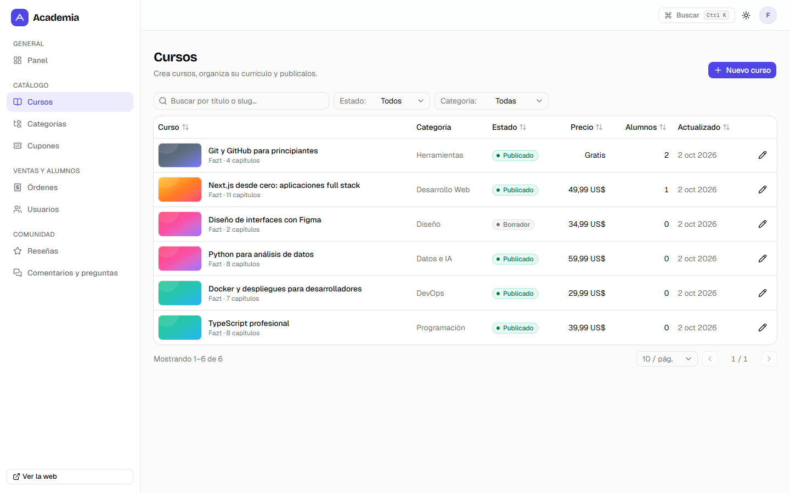
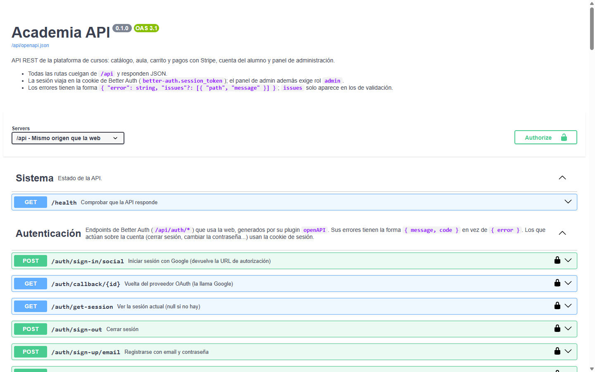

# Academia

Plataforma de venta de cursos en video organizados en secciones y capítulos, al estilo Udemy. Es una academia propia: los administradores crean y venden los cursos y los alumnos los compran y los siguen desde el aula.

Monorepo con **Next.js 16**, **Hono**, **PostgreSQL** y **Better Auth**. Los pagos van por **Stripe**, el video por **Cloudflare Stream**, los emails por **Resend** y los archivos por **DigitalOcean Spaces**.



## Funcionalidades

- **Portada** de estilo terminal con datos reales: el temario del curso más popular, el catálogo destacado, el número de estudiantes y reseñas de alumnos.
- **Catálogo público** con búsqueda, filtros por categoría, nivel y precio, y ordenación. Página de detalle con temario, vistas previas gratuitas, instructor, reseñas, SEO (metadata, JSON-LD `Course`) y sitemap.
- **Compra**: carrito (también para invitados, se fusiona al iniciar sesión), cupones (porcentaje o monto fijo, por curso o globales, con límite de usos y caducidad), "comprar ahora", cursos gratis y Stripe Checkout. El precio lo calcula siempre la API.
- **Aula**:
  - Reproductor de Cloudflare Stream con URLs firmadas y progreso que se reanuda.
  - Temario con capítulos completados y recursos descargables.
  - Comentarios y preguntas por capítulo (con respuestas del instructor y preguntas resueltas).
  - Reseñas y certificado PDF verificable al completar el curso.
- **Cuenta**: registro con verificación de email, login (también con Google, GitHub o Microsoft), recuperación de contraseña, perfil (datos, contraseña, avatar y cuentas conectadas), mis cursos, mis compras y mis certificados.
- **Panel de administración**:
  - Dashboard de ventas.
  - CRUD de cursos con constructor de temario (arrastrar y soltar), subida de videos a Stream (tus, por trozos, se recupera de cortes de red) y recursos.
  - Categorías, cupones, usuarios (rol y accesos manuales), órdenes (con reembolso), moderación de reseñas y bandeja de preguntas sin responder.
- **Documentación de la API** con OpenAPI 3.1 y Swagger UI en `/api/docs`, generada a partir de las rutas y sus validadores Zod.
- Tema claro/oscuro y paleta de comandos (`Ctrl K`) en toda la aplicación.

## Capturas

| | |
|---|---|
|  |  |
| **Catálogo** con búsqueda, filtros y ordenación | **Detalle del curso** con temario, vistas previas y tarjeta de compra |
|  |  |
| **Aula**: reproductor, temario con progreso y preguntas con respuesta del instructor | **Carrito** con un cupón aplicado |
|  |  |
| **Mis cursos** con el progreso de cada uno | **Panel de administración**: temario con arrastrar y soltar |
|  |  |
| **Panel**: cursos con búsqueda, filtros y paginación | **Documentación de la API** en Swagger UI |

Las capturas usan los datos de demostración del seed. Sin credenciales de Cloudflare Stream, el aula muestra el aviso de «video no disponible» en lugar del reproductor.

## Stack

| Parte | Tecnología |
|---|---|
| Web (`apps/web`, puerto 3010) | Next.js 16 (App Router), Tailwind v4, shadcn/ui, TanStack Query, react-hook-form |
| API (`apps/api`, puerto 3011) | Hono sobre Node, Drizzle ORM, PostgreSQL, Better Auth |
| Compartido (`packages/shared`) | Esquemas Zod, enums y cálculo de precios |
| Documentación de la API | OpenAPI 3.1 con `hono-openapi` y Swagger UI (`@hono/swagger-ui`) |
| Servicios | Stripe (pagos), Cloudflare Stream (video), Resend (email), DigitalOcean Spaces (archivos), Google, GitHub y Microsoft (login) |

En desarrollo la web reenvía `/api/*` a la API (`rewrites` de Next), así que todo va por el mismo origen y la cookie de sesión no necesita CORS. El cliente de la web está tipado de extremo a extremo con Hono RPC.

## Puesta en marcha

Requisitos: Node 22 o superior, pnpm 10 y Docker.

```bash
pnpm install
docker compose up -d                       # Postgres en localhost:5437
cp apps/api/.env.example apps/api/.env      # revisa los valores
cp apps/web/.env.example apps/web/.env.local
pnpm db:migrate
pnpm db:seed                                # datos de demostración
pnpm dev                                    # web en :3010 y API en :3011
```

El seed crea estos datos:

- Admin: `admin@academia.test` / `admin12345`.
- Alumno: `alumno@academia.test` / `alumno12345`.
- Seis cursos de ejemplo y el cupón `BIENVENIDA20`.

Los capítulos de ejemplo no tienen video reproducible salvo que definas `SEED_STREAM_UID`, que debe ser el uid de un video real de tu cuenta de Stream.

Sin `RESEND_API_KEY`, los emails (verificación, recuperación de contraseña, recibos) se imprimen en la consola de la API. Así puedes copiar los enlaces durante el desarrollo.

## Configurar los servicios

Todas las variables están documentadas en `apps/api/.env.example`.

### Stripe

1. Copia la clave secreta de test a `STRIPE_SECRET_KEY`.
2. En local, reenvía los webhooks con `stripe listen --forward-to localhost:3011/api/webhooks/stripe` y copia el `whsec_…` a `STRIPE_WEBHOOK_SECRET`.
3. En producción, crea un endpoint hacia `https://tu-dominio/api/webhooks/stripe` con estos eventos:
   - `checkout.session.completed`
   - `checkout.session.async_payment_succeeded`
   - `checkout.session.async_payment_failed`
   - `checkout.session.expired`
   - `charge.refunded`
   - `charge.dispute.created`

No hay que crear productos en Stripe: cada Checkout Session se crea con los precios ya calculados por la API.

### Cloudflare Stream

1. Pon en `CLOUDFLARE_ACCOUNT_ID` y `CLOUDFLARE_STREAM_API_TOKEN` (permiso *Stream: Edit*) los datos de tu cuenta. En `STREAM_CUSTOMER_CODE` va el código de tu subdominio `customer-<código>.cloudflarestream.com`.
2. Ejecuta `pnpm stream:setup`. Crea la signing key con la que la API firma localmente los tokens de reproducción e imprime las variables que tienes que añadir.
3. En producción, ejecuta `pnpm stream:setup --webhook-url https://tu-dominio/api/webhooks/stream` para registrar el webhook. En local no hace falta: el panel consulta el estado del video mientras se procesa.

Todos los videos se suben con `requireSignedURLs`. Solo se emite un token a quien tiene matrícula activa, a los admins o para capítulos de vista previa.

### DigitalOcean Spaces

1. Crea un bucket y una clave de acceso, y rellena las variables `SPACES_*`. `SPACES_PUBLIC_URL` es la URL pública (o la del CDN) del bucket.
2. Configura el CORS del bucket para permitir `POST` desde el origen de la web, porque las subidas usan POST prefirmado con límite de tamaño.
3. Las portadas y los avatares son públicos. Los recursos de los capítulos son privados y se descargan con URLs temporales.

### Resend

Rellena `RESEND_API_KEY` y `EMAIL_FROM` con un dominio verificado en Resend.

### Acceso con Google, GitHub y Microsoft

Cada proveedor es opcional: solo aparece su botón "Continuar con …" si están su ID y su secreto en la API. Los callbacks pasan por el origen de la web (`<APP_URL>/api/auth/callback/<proveedor>`), no por el puerto de la API. Funcionamiento común:

- Si no existe una cuenta con ese email, se crea una nueva con rol de alumno.
- Si ya existe, el proveedor se une a ella solo cuando el email está verificado en las dos partes. Si no, el login explica qué hacer. Así nadie puede registrar el email de otra persona y quedarse con su cuenta cuando el dueño entre con el proveedor.
- Si `REQUIRE_EMAIL_VERIFICATION=true`, quien no tenga el email verificado en el proveedor no puede entrar hasta confirmarlo con el enlace que enviamos.
- Desde el perfil se pueden conectar y desconectar proveedores, también con un email distinto. No se puede quitar el último método de acceso.
- Quien entró solo con un proveedor puede crear una contraseña desde el perfil con un enlace por email.
- Los tokens de los proveedores se guardan cifrados.

#### Google

1. En Google Cloud Console, abre *APIs y servicios > Credenciales* y crea un ID de cliente de OAuth de tipo *Aplicación web*. Antes tendrás que configurar la pantalla de consentimiento.
2. Añade los orígenes de JavaScript autorizados: `http://localhost:3010` y tu dominio de producción.
3. Añade las URI de redirección autorizadas: `http://localhost:3010/api/auth/callback/google` y `https://tu-dominio/api/auth/callback/google`. El callback va al origen de la web (`APP_URL`), no al puerto de la API.
4. Copia el ID y el secreto a `GOOGLE_CLIENT_ID` y `GOOGLE_CLIENT_SECRET`, y reinicia la API.

#### GitHub

1. Crea una OAuth App en [github.com/settings/developers](https://github.com/settings/developers). En *Homepage URL* pon el valor de `APP_URL` y en *Authorization callback URL* pon `<APP_URL>/api/auth/callback/github`, por ejemplo `http://localhost:3010/api/auth/callback/github`. Necesitas una app para local y otra para producción, porque GitHub solo admite una URL de callback por app.
2. Copia el *Client ID* a `GITHUB_CLIENT_ID`, genera un *client secret*, cópialo a `GITHUB_CLIENT_SECRET` y reinicia la API.

#### Microsoft (Entra ID)

1. En el [Microsoft Entra admin center](https://entra.microsoft.com), ve a *App registrations* > *New registration*.
   - En *Supported account types* elige *Accounts in any organizational directory and personal Microsoft accounts*. Debe cuadrar con `MICROSOFT_TENANT_ID=common`. Si solo quieres cuentas de tu organización, elige *Single tenant* y pon el ID del tenant.
   - En *Redirect URI* elige la plataforma *Web* con `http://localhost:3010/api/auth/callback/microsoft`. En producción añade `https://tu-dominio/api/auth/callback/microsoft`.
2. Copia el *Application (client) ID* a `MICROSOFT_CLIENT_ID`. En *Certificates & secrets* crea un *client secret* y copia su **Value** (no el *Secret ID*) a `MICROSOFT_CLIENT_SECRET`. Caduca: apunta la fecha para renovarlo.
3. En *Token configuration* > *Add optional claim* > *ID* marca `email`. Después, en *Manifest*, añade a `optionalClaims.idToken`:

   ```json
   { "name": "xms_edov", "source": null, "essential": false, "additionalProperties": [] }
   ```

`xms_edov` indica que Microsoft ha verificado el email. Solo en ese caso la cuenta nace verificada y entrar con Microsoft se une a una cuenta existente con el mismo email. Sin él (o si Microsoft no lo garantiza), la cuenta se crea pero hay que confirmar el email con el enlace que enviamos antes de entrar. Así evitamos que el admin de otro tenant ponga tu email en su usuario y entre en tu cuenta (ataque *nOAuth*).

Solo se piden los scopes `openid profile email`: la app no accede a Microsoft Graph ni guarda refresh tokens.

## Scripts

| Comando | Descripción |
|---|---|
| `pnpm dev` | Web y API en modo desarrollo |
| `pnpm typecheck` | Comprobación de tipos en todo el monorepo |
| `pnpm lint` | ESLint (web) y comprobación de tipos (api y shared) |
| `pnpm test` | Tests unitarios (precios, reglas de progreso, especificación OpenAPI) |
| `pnpm --filter @academia/api test:integration` | Tests de la API contra una base `academia_test` en el Postgres de Docker |
| `pnpm db:generate` | Genera una migración tras cambiar el esquema de Drizzle |
| `pnpm db:migrate` / `pnpm db:seed` | Aplica migraciones / carga los datos de demostración |
| `pnpm stream:setup` | Configura la signing key (y el webhook) de Cloudflare Stream |

## Decisiones de diseño

- **El servidor decide el precio.** El carrito y el checkout usan la misma función (`priceCart` en `packages/shared`). El canje de un cupón se reserva de forma atómica al crear la orden y se libera si la sesión de Stripe expira o falla.
- **Los webhooks son idempotentes.** Se registra cada `event.id` y las matrículas se insertan con `ON CONFLICT`. Una sesión completada sin cobrar (pago asíncrono) no matricula hasta `async_payment_succeeded`.
- **El progreso no se puede falsificar llamando a la API.** Un capítulo solo se completa al llegar al 90 % y si ha pasado al menos la mitad de su duración en tiempo real.
- **El rol no se puede auto-asignar.** `role`, `headline` y `bio` son campos de Better Auth con `input: false`.
- **No nos fiamos del email de Microsoft.** La cuenta de Microsoft se identifica por su `oid` y su email solo cuenta como verificado con el claim `xms_edov`.
- **Las respuestas públicas tienen columnas explícitas.** Nunca exponen uids de Stream, emails ni contenido oculto.

## Antes de producción

- Enruta `/api` con el proxy de delante (Caddy, Cloudflare, etc.) en lugar de los `rewrites` de Next. Así se conserva la IP real (el rate limit de Better Auth la usa) y se evita el límite de tiempo del proxy de Next.
- Adapta los textos de términos, privacidad y reembolsos a tu negocio y a la legislación que te aplique.
- Valora Stripe Tax si vendes en la UE.
- Configura reintentos para los emails, monitorización de errores y backups de la base de datos.

## Documentación

- [Arquitectura](docs/ARCHITECTURE.md): componentes, estructura del monorepo, API, modelo de datos, flujos clave, autenticación, frontend, decisiones de diseño y tests.
- **API**: con el proyecto en marcha, Swagger UI está en [localhost:3010/api/docs](http://localhost:3010/api/docs) y la especificación en `/api/openapi.json`. Fuera de producción se activan solos; en producción solo con `ENABLE_API_DOCS=true`. Cada ruta nueva necesita su `doc("…")`, o falla el test `apps/api/src/routes/docs.test.ts`.

## Licencia

[MIT](LICENSE) © 2026 Fazt.
