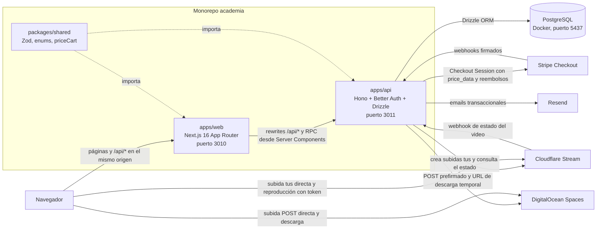
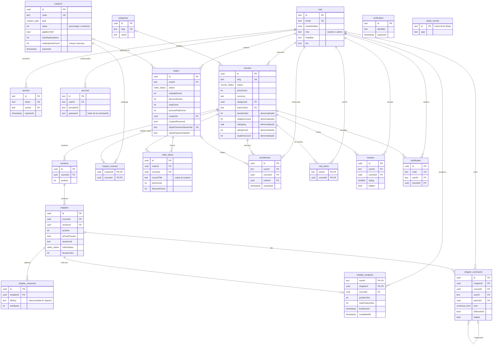
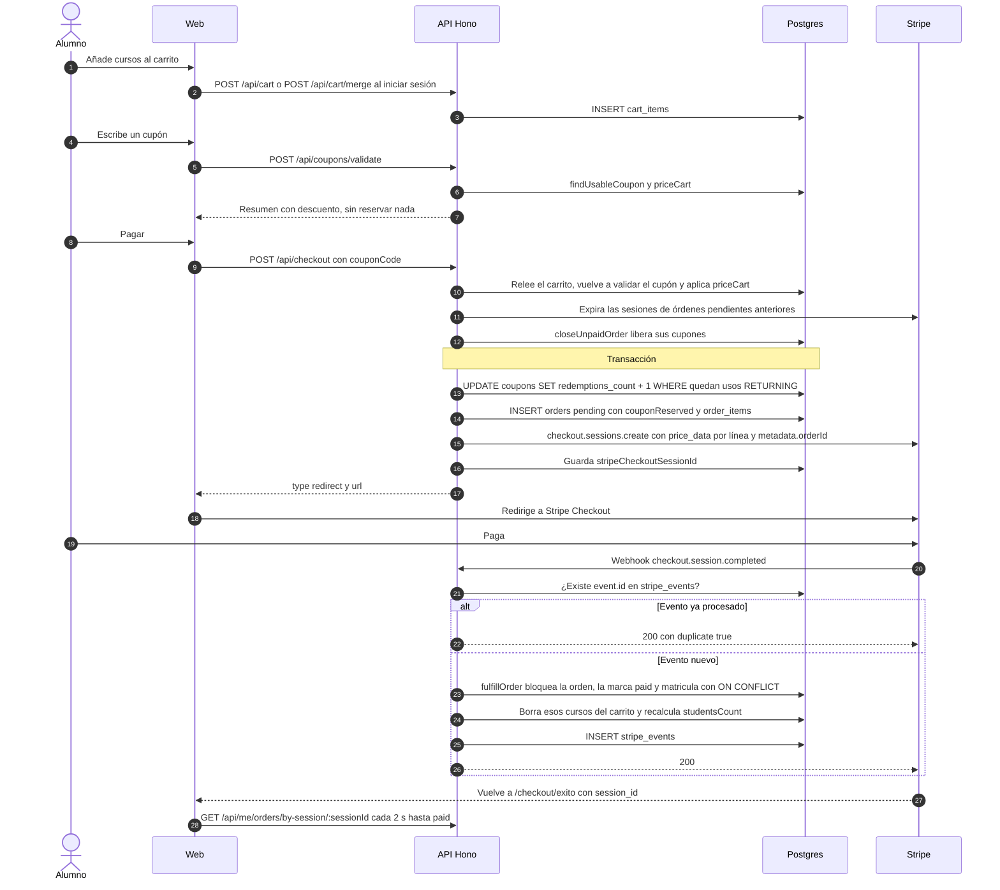
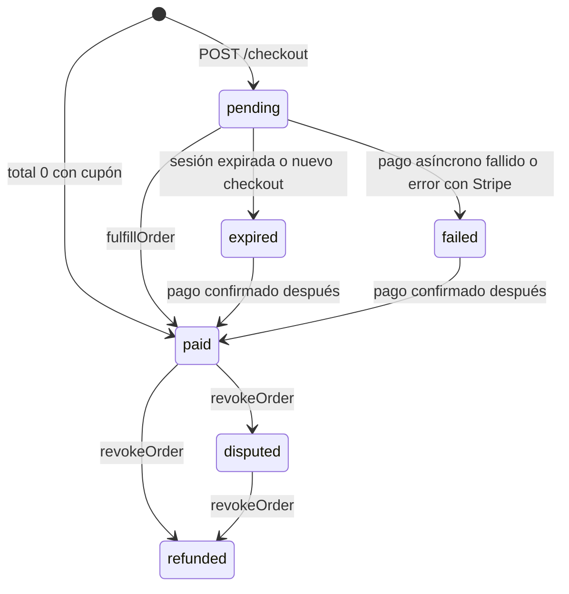
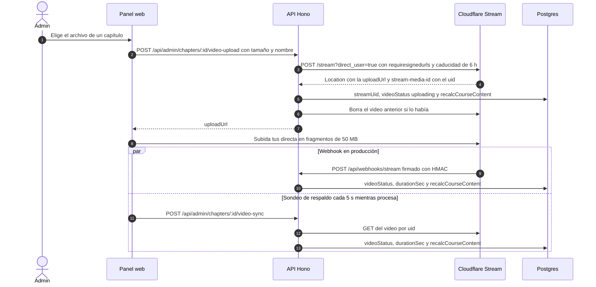
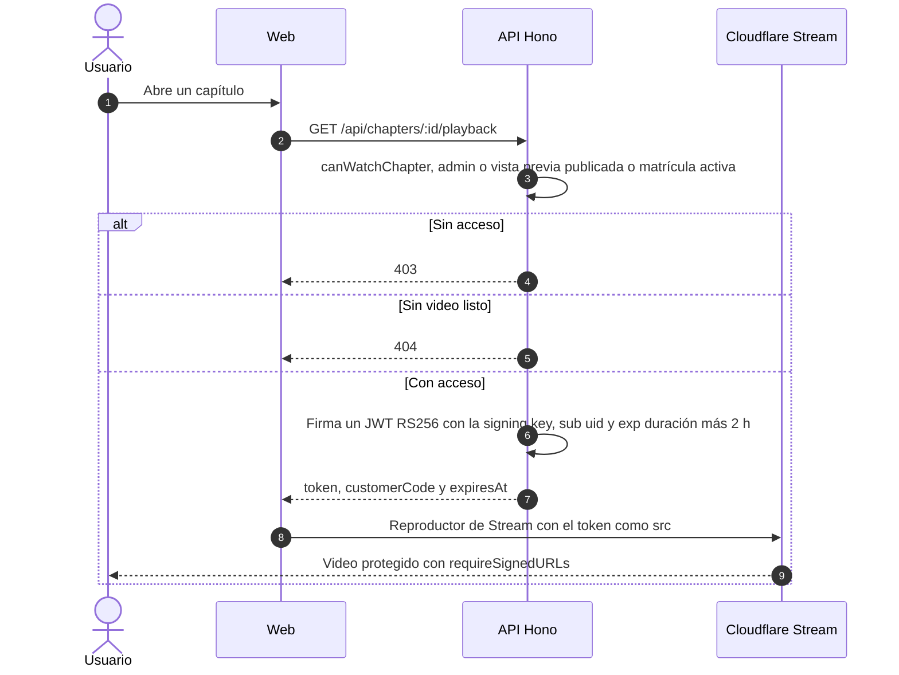
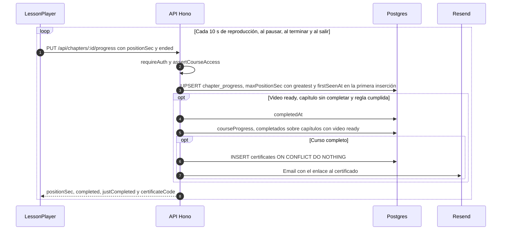

# Arquitectura de Academia

Academia es una plataforma de venta de cursos en video al estilo Udemy, pero con un solo vendedor: los administradores crean y venden los cursos, y los alumnos los compran y los siguen desde el aula.

Este documento explica cómo está construido el sistema. La instalación, los scripts, las variables de entorno y la configuración de Stripe, Cloudflare Stream, DigitalOcean Spaces y Resend están en el [README](../README.md).

Las rutas de archivo se indican desde la raíz del repositorio.

> **Trabajo en curso.** Mientras se escribía este documento había cambios que aún no estaban en ningún commit y que no se describen aquí: el acceso con Google (`socialProviders` de Better Auth en `apps/api/src/lib/auth.ts`, `GET /api/auth-providers`, `POST /api/me/password` y `apps/web/src/components/auth/google-button.tsx`) y la documentación OpenAPI de la API (`apps/api/src/lib/openapi.ts`, `apps/api/src/routes/docs.ts` y la variable `ENABLE_API_DOCS`). Cuando se integren, habrá que actualizar las secciones 3 y 6.

**Contenido**

1. [Visión general](#1-visión-general)
2. [Estructura del monorepo](#2-estructura-del-monorepo)
3. [API](#3-api)
4. [Modelo de datos](#4-modelo-de-datos)
5. [Flujos clave](#5-flujos-clave)
6. [Autenticación y autorización](#6-autenticación-y-autorización)
7. [Frontend](#7-frontend)
8. [Decisiones de diseño y limitaciones](#8-decisiones-de-diseño-y-limitaciones)
9. [Tests](#9-tests)

---

## 1. Visión general

El navegador solo habla con un origen: la web Next.js (puerto 3010). Las peticiones a `/api/*` se reenvían a la API Hono (puerto 3011) con los `rewrites` de `apps/web/next.config.ts`, así que la cookie de sesión viaja sola y no hace falta CORS.

La API es la única pieza que accede a PostgreSQL y a las claves de los servicios externos. Decide todo lo importante: quién es el usuario, a qué tiene acceso, cuánto cuesta un carrito y cuándo se completa un capítulo.

Los archivos grandes no pasan por la API. El navegador sube los videos directamente a Cloudflare Stream y las imágenes y recursos a DigitalOcean Spaces, con URLs de subida que genera o firma la API.



---

## 2. Estructura del monorepo

Monorepo pnpm. `pnpm-workspace.yaml` declara los paquetes `apps/*` y `packages/*` y un `catalog` que fija una única versión de `hono`, `zod`, `typescript`, `@types/node` y `vitest` (cada `package.json` las pide como `"catalog:"`).

```text
academia/
├── apps/
│   ├── api/                  @academia/api
│   │   ├── drizzle/          migraciones SQL (drizzle-kit)
│   │   ├── scripts/          stream-setup.ts
│   │   ├── src/
│   │   │   ├── app.ts        montaje de rutas, middlewares, errores y AppType
│   │   │   ├── index.ts      servidor @hono/node-server
│   │   │   ├── env.ts        variables de entorno validadas con Zod
│   │   │   ├── db/           cliente, esquema, migrate.ts y seed.ts
│   │   │   ├── lib/          auth, stripe, stream, storage, email, certificate-pdf, validate, errors, pagination
│   │   │   ├── middleware/   sesión, requireAuth y requireAdmin
│   │   │   ├── routes/       public, learn, cart, me, webhooks y admin/*
│   │   │   └── services/     orders, coupons, progress, access, course-stats y course-queries
│   │   └── test/             tests de integración
│   └── web/                  @academia/web
│       └── src/
│           ├── app/          (landing), (site), (auth), aprender y admin
│           ├── components/   ui (shadcn), admin, course, learn, cart, landing, layout...
│           ├── hooks/        use-checkout y use-library
│           ├── lib/          api.ts, server-api.ts, auth-client.ts, upload.ts...
│           └── proxy.ts      redirecciones según la cookie de sesión
├── packages/
│   └── shared/               @academia/shared
├── docker-compose.yml        PostgreSQL en el puerto 5437
└── pnpm-workspace.yaml
```

| Paquete | Responsabilidad | Integración |
|---|---|---|
| `apps/web` | Interfaz: portada, catálogo, carrito, aula, cuenta y panel de administración. No accede a la base de datos. | Depende de `@academia/api` solo para tipos (`import type { AppType }`) y de `@academia/shared`, que transpila con `transpilePackages`. |
| `apps/api` | Lógica de negocio, autorización, persistencia e integraciones externas. | Su `package.json` solo exporta tipos (`"types": "./src/app.ts"`). `tsup` empaqueta `index`, `migrate` y `seed` e incluye `@academia/shared` (`noExternal`). |
| `packages/shared` | Contrato común: esquemas Zod (formularios y API), enums con sus etiquetas en español, `priceCart` y formateadores (`formatPrice`, `formatDuration`, `formatClock`, `slugify`). | Se consume como TypeScript sin compilar (`exports: ./src/index.ts`). |

---

## 3. API

### 3.1 Recorrido de una petición

`apps/api/src/app.ts` crea `new Hono<AppEnv>().basePath("/api")` y registra, en este orden:

1. `logger()` y `secureHeaders()` para todas las rutas.
2. `onError` y `notFound`, que dan el formato de errores (ver 3.4).
3. `GET /api/health`.
4. `GET|POST /api/auth/*`: lo atiende directamente `auth.handler` de Better Auth.
5. `/api/webhooks/*` (`apps/api/src/routes/webhooks.ts`): va antes de los middlewares de cuerpo y sesión porque necesita el cuerpo raw para verificar firmas.
6. Para el resto (se excluyen `/api/auth/` y `/api/webhooks/`): `bodyLimit` de 1 MB y `sessionMiddleware`, que deja `c.var.user` y `c.var.session` (o `null`).
7. Los módulos: `publicRoutes`, `learnRoutes` y `cartRoutes` en `/`, `meRoutes` en `/me` y `adminRoutes` en `/admin`.

`apps/api/src/env.ts` valida las variables de entorno con Zod al arrancar y detiene el proceso si no son válidas. Las de Stripe, Stream, Spaces y Resend son opcionales: si faltan, la API arranca igual, los endpoints que las necesitan devuelven un error (503 en casi todos los casos) y los emails se imprimen en consola.

### 3.2 Módulos de rutas

Todas las rutas llevan el prefijo `/api`.

| Módulo | Archivo | Acceso | Endpoints |
|---|---|---|---|
| Pública | `apps/api/src/routes/public.ts` | Anónimo | `GET /stats`, `GET /reviews/featured`, `GET /categories`, `GET /courses` (búsqueda, filtros, orden y paginación), `GET /courses/by-ids` (carrito de invitado), `GET /courses/:slug`, `GET /courses/:slug/reviews`, `GET /certificates/:code` y `GET /certificates/:code/pdf` |
| Aula | `apps/api/src/routes/learn.ts` | `playback` admite anónimos (vistas previas); el resto exige sesión y casi todo, además, matrícula activa (ver sección 6) | `GET /chapters/:id/playback`, `PUT /chapters/:id/progress`, `GET /chapters/:id/resources/:resourceId/download`, `GET` y `POST /chapters/:id/comments`, `PATCH` y `DELETE /comments/:id`, `POST /comments/:id/resolve`, `PUT /courses/:id/review` |
| Carrito y checkout | `apps/api/src/routes/cart.ts` | `requireAuth` | `GET` y `POST /cart`, `DELETE /cart/:courseId`, `POST /cart/merge`, `POST /coupons/validate`, `POST /checkout` |
| Alumno | `apps/api/src/routes/me.ts` | `requireAuth` en todo el módulo | `GET` y `PATCH /me`, `POST /me/avatar-upload`, `PUT /me/avatar`, `GET /me/library`, `GET /me/courses`, `GET /me/courses/:slug/learn`, `GET /me/orders`, `GET /me/orders/by-session/:sessionId`, `GET /me/certificates` |
| Admin | `apps/api/src/routes/admin/` | `requireAdmin` en `index.ts` | `stats.ts`: dashboard de ventas. `courses.ts`: CRUD de cursos, estado, secciones, capítulos, reordenación del temario, video (`video-upload`, `video-sync`, borrar) y recursos. `catalog.ts`: categorías, cupones y `POST /admin/uploads/presign`. `people.ts`: usuarios (rol y matrículas manuales), órdenes (reembolso), moderación de reseñas y comentarios |
| Webhooks | `apps/api/src/routes/webhooks.ts` | Firma del proveedor, sin sesión | `POST /webhooks/stripe`, `POST /webhooks/stream` |

### 3.3 Middlewares de autenticación

Están en `apps/api/src/middleware/auth.ts`:

- `sessionMiddleware`: llama a `auth.api.getSession({ headers })` y nunca rechaza la petición.
- `requireAuth`: 401 si no hay usuario.
- `requireAdmin`: 401 sin usuario y 403 si `role !== "admin"`.
- `currentUser(c)` devuelve el usuario tipado (o lanza 401) e `isAdmin(user)` comprueba el rol.

Las reglas más finas (matrícula, autoría de un comentario) están en `apps/api/src/services/access.ts` y en cada handler.

### 3.4 Validación y formato de errores

- Las entradas se validan con `validate(target, schema)` (`apps/api/src/lib/validate.ts`), un envoltorio de `@hono/zod-validator` que **lanza** `HTTPException(400)` con el `ZodError` como `cause`. Al lanzar en vez de devolver una respuesta, los tipos del cliente RPC solo incluyen las respuestas correctas.
- Casi todos los esquemas vienen de `packages/shared/src/schemas.ts`, de modo que la web valida los formularios con el mismo esquema que la API.
- Los handlers lanzan los helpers de `apps/api/src/lib/errors.ts`: `badRequest`, `unauthorized`, `forbidden`, `notFound`, `conflict` y `serviceUnavailable`.
- `app.onError` responde siempre en JSON. `issues` solo aparece en errores de validación:

```json
{
  "error": "Datos no válidos",
  "issues": [{ "path": "priceCents", "message": "El precio mínimo es 0,50 o gratis" }]
}
```

- Una excepción no controlada se registra en consola y devuelve `500 { "error": "Error interno del servidor" }`. Una ruta inexistente devuelve `404 { "error": "Ruta no encontrada" }`. Las rutas de Better Auth usan su propio formato.
- En la web, `call()` (`apps/web/src/lib/api.ts`) convierte cualquier respuesta no `ok` en `ApiError(message, status, issues)`, y `applyServerErrors` (`apps/web/src/components/admin/form-errors.ts`) lleva los `issues` y los 409 a los campos del formulario.

### 3.5 Servicios y librerías

| Archivo | Qué hace |
|---|---|
| `apps/api/src/services/orders.ts` | `fulfillOrder` (pago confirmado: orden pagada y matrícula, idempotente con `SELECT … FOR UPDATE`), `closeUnpaidOrder` (orden expirada o fallida, libera el cupón), `revokeOrder` (reembolso o disputa, revoca matrículas) y `enrollFree` (matrícula directa). |
| `apps/api/src/services/coupons.ts` | `findUsableCoupon` (código en mayúsculas, activo, sin caducar y con usos), `reserveCouponRedemption` (`UPDATE` condicional atómico) y `releaseCouponRedemption`. |
| `apps/api/src/services/progress.ts` | Regla de completado, `recordProgress`, `courseProgress`, emisión idempotente de certificados y último capítulo visto. |
| `apps/api/src/services/access.ts` | `hasActiveEnrollment`, `assertCourseAccess`, `loadChapter` y `canWatchChapter`. |
| `apps/api/src/services/course-stats.ts` | Recalcula los campos denormalizados de `courses` (ver 4.3). |
| `apps/api/src/services/course-queries.ts` | DTOs públicos: `courseCardColumns` y `courseCardQuery` para las tarjetas, y `loadCurriculum`, que oculta `streamUid` y `fileKey` salvo a los admins. |
| `apps/api/src/lib/auth.ts` | Configuración de Better Auth. |
| `apps/api/src/lib/stripe.ts` | Cliente de Stripe perezoso; 503 si falta `STRIPE_SECRET_KEY`. |
| `apps/api/src/lib/stream.ts` | API de Cloudflare Stream (subidas tus, estado, borrado, `requireSignedURLs`), firma RS256 de tokens de reproducción y verificación del webhook. |
| `apps/api/src/lib/storage.ts` | Spaces (S3): POST prefirmado con reglas por tipo de archivo, URL pública, URL de descarga temporal y borrado. |
| `apps/api/src/lib/email.ts` | Envío con Resend o impresión en consola, y plantillas HTML (verificación, recuperación, recibo, certificado y respuesta del instructor). Nunca lanza. |
| `apps/api/src/lib/certificate-pdf.tsx` | Certificado en PDF (A4 apaisado) con `@react-pdf/renderer`. |
| `apps/api/src/lib/pagination.ts` | `paginate`, `offsetOf`, `orderByFrom` (solo ordena por columnas de una lista blanca) y `likePattern` (escapa los comodines de `LIKE`). |

### 3.6 `AppType` y Hono RPC

```ts
// apps/api/src/app.ts
const routes = app
  .route("/", publicRoutes)
  .route("/", learnRoutes)
  .route("/", cartRoutes)
  .route("/me", meRoutes)
  .route("/admin", adminRoutes);

export type AppType = typeof routes;
```

- Cada módulo es una cadena `new Hono<AppEnv>().get(...).post(...)`. Encadenar es lo que conserva en el tipo las rutas, los parámetros, las entradas validadas y las respuestas de `c.json(...)`.
- `AppType` solo incluye los módulos encadenados: `/health`, `/auth/*` y `/webhooks/*` se registran aparte y no forman parte del cliente.
- La web crea el cliente con `hc<AppType>(origen).api` (`apps/web/src/lib/api.ts` y `apps/web/src/lib/server-api.ts`) y deriva los tipos de respuesta con `InferResponseType` (`apps/web/src/lib/types.ts`, `apps/web/src/components/learn/types.ts` y `apps/web/src/components/admin/types.ts`). Un cambio incompatible en una respuesta hace fallar `pnpm typecheck` en los componentes que la usan.

Para añadir un endpoint basta con encadenarlo en su módulo, validar con `validate()` y responder con `c.json()`. No hay paso de generación de código.

---

## 4. Modelo de datos

Convenciones:

- Drizzle con `casing: "snake_case"` (`apps/api/src/db/index.ts` y `apps/api/drizzle.config.ts`): las propiedades van en camelCase en TypeScript y las columnas en snake_case en la base. Este documento usa los nombres de TypeScript.
- El esquema está repartido en `apps/api/src/db/schema/auth.ts` (tablas de Better Auth), `catalog.ts`, `commerce.ts` y `learning.ts`. Los enums de Postgres se generan con las constantes de `packages/shared/src/enums.ts`.
- No hay `relations()` de Drizzle: las relaciones son claves foráneas y las consultas usan `join` explícitos.
- Los importes son enteros en céntimos, con la moneda en `courses.currency` y `orders.currency`.
- Las migraciones están en `apps/api/drizzle/` (de momento solo `0000_init.sql`). `apps/api/src/db/migrate.ts` crea antes la extensión `pg_trgm`, que necesita el índice GIN `courses_title_trgm_idx`.

### 4.1 Diagrama entidad-relación

Se muestran las claves y los campos más relevantes de cada tabla.



### 4.2 Tablas por dominio

| Dominio | Tablas | Notas |
|---|---|---|
| Autenticación | `user`, `session`, `account`, `verification` | Las gestiona Better Auth. `user` añade `role`, `headline` y `bio`. La contraseña está en `account.password`. |
| Catálogo | `categories`, `courses`, `sections`, `chapters`, `chapter_resources` | `courses.status`: `draft`, `published` o `archived`. `chapters.videoStatus`: `none`, `uploading`, `processing`, `ready` o `error`. `chapters.courseId` repite la relación que ya da la sección; las consultas por curso lo usan directamente. |
| Comercio | `coupons`, `coupon_courses`, `orders`, `order_items`, `enrollments`, `cart_items`, `stripe_events` | `order_items` copia título, precio y descuento en el momento de la compra. `enrollments` es única por (`userId`, `courseId`) y se revoca con `revokedAt` en lugar de borrarse. `stripe_events` registra los eventos ya procesados. |
| Aprendizaje | `chapter_progress`, `reviews`, `chapter_comments`, `certificates` | Una reseña y un certificado por alumno y curso. `chapter_comments` tiene dos tipos (`comment` y `question`) y un solo nivel de respuestas (`parentId`). `chapter_progress` y `chapter_comments` guardan `courseId` para consultas por curso. |

Reglas de borrado: casi todas las claves foráneas usan `cascade`. Las excepciones son `courses.instructorId` y `order_items.courseId` (`restrict`), y `courses.categoryId`, `orders.couponId` y `enrollments.orderId` (`set null`). Además, `DELETE /api/admin/courses/:id` rechaza los cursos con ventas o alumnos: hay que archivarlos.

### 4.3 Campos denormalizados

| Campo | Contenido | Lo recalcula | Se invoca desde |
|---|---|---|---|
| `courses.durationSec` | Suma de la duración de los capítulos con video `ready` | `recalcCourseContent` | Crear o borrar capítulos y secciones, `video-upload`, `video-sync` y borrar video (admin), webhook de Stream y seed |
| `courses.chaptersCount` | Número de capítulos del curso, con o sin video | `recalcCourseContent` | Los mismos puntos |
| `courses.ratingAvg` y `courses.ratingCount` | Media y número de reseñas no ocultas | `recalcCourseRating` | `PUT /courses/:id/review`, `PATCH /admin/reviews/:id` y seed |
| `courses.studentsCount` | Matrículas activas (`revokedAt` nulo) | `recalcCourseStudents` | `fulfillOrder`, `enrollFree`, `revokeOrder`, revocar una matrícula desde el panel y seed |
| `coupons.redemptionsCount` | Canjes, incluidas las reservas de órdenes pendientes | `reserveCouponRedemption` y `releaseCouponRedemption` | `POST /checkout` y `closeUnpaidOrder` |
| `chapters.videoStatus` y `chapters.durationSec` | Copia del estado del video en Stream | Webhook de Stream y `POST /admin/chapters/:id/video-sync` | Procesamiento del video |

Las funciones de `apps/api/src/services/course-stats.ts` reciben una transacción (`DbOrTx`) y se ejecutan en la misma transacción que el cambio que las provoca, salvo en el webhook de Stream y en el seed.

---

## 5. Flujos clave

### 5.1 Compra



Detalles del checkout (`apps/api/src/routes/cart.ts`):

- **El precio lo calcula siempre la API.** `POST /checkout` no recibe importes: relee el carrito (`loadCart` también elimina cursos despublicados o ya comprados) o el curso de "Comprar ahora" (`courseId`), vuelve a validar el cupón y aplica `priceCart` (`packages/shared/src/pricing.ts`), la misma función que usa `POST /coupons/validate`.
- Rechaza con 400 un cupón que no aplica a los cursos y un total entre 1 y 49 céntimos (`MIN_CHARGE_CENTS`).
- **Total 0 sin cupón** (cursos gratis): `enrollFree` matricula sin crear orden. **Total 0 gracias a un cupón**: la orden se crea directamente como `paid`, con el canje consumido, y se matricula sin pasar por Stripe.
- **Reserva atómica del cupón.** `reserveCouponRedemption` es un único `UPDATE … WHERE active AND sin caducar AND redemptions_count < max_redemptions RETURNING`. Si dos compras compiten por el último uso, solo una recibe la fila y la otra obtiene un 409. La reserva se libera en `closeUnpaidOrder`: sesión expirada, pago asíncrono fallido, error al crear la sesión de Stripe o un checkout nuevo del mismo usuario.
- La Checkout Session caduca a los 31 minutos (`CHECKOUT_TTL_MIN`; Stripe exige al menos 30) y lleva `metadata.orderId` en la sesión y en el PaymentIntent.

Detalles del webhook (`apps/api/src/routes/webhooks.ts`):

- **Idempotencia por `event.id`.** Verifica la firma con `constructEventAsync`; si el `event.id` ya está en `stripe_events` responde `duplicate: true`; si no, lo procesa y después lo registra. Si el manejador falla, el evento no queda registrado y Stripe lo reintenta. Los manejadores también son idempotentes (bloqueo de fila y `ON CONFLICT`), así que dos entregas simultáneas no duplican matrículas ni recibos.
- **Pagos asíncronos.** Si `checkout.session.completed` llega con un `payment_status` distinto de `paid` o `no_payment_required`, solo se guarda el PaymentIntent. La matrícula espera a `checkout.session.async_payment_succeeded`.
- **Reembolsos y disputas.** `charge.refunded` (solo reembolsos completos; los parciales se registran en consola y no revocan el acceso) y `charge.dispute.created` buscan la orden por `stripePaymentIntentId` y llaman a `revokeOrder`. `POST /api/admin/orders/:id/refund` crea el reembolso en Stripe y revoca en el momento; el webhook que llega después no cambia nada.
- `fulfillOrder` envía el recibo por email después de confirmar la transacción.

Estados de una orden según el código:



`fulfillOrder` solo ignora las órdenes `paid`, `refunded` o `disputed`, por eso un pago confirmado tarde se entrega aunque la orden ya estuviera `expired` o `failed`.

### 5.2 Video con Cloudflare Stream

Subida y procesamiento:



Reproducción:



- Las subidas se crean con `requiresignedurls` y, en producción, con `allowedorigins` limitado al host de `APP_URL` (`apps/api/src/lib/stream.ts`). Si un video llega a `ready` sin `requireSignedURLs`, el webhook o `video-sync` llaman a `enforceVideoSecurity`.
- `mapVideoState` traduce el estado de Stream: `ready` (y `readyToStream`) pasa a `ready`, `error` a `error`, `pendingupload` a `uploading` y el resto a `processing`.
- El webhook verifica la cabecera `Webhook-Signature` (`time=…,sig1=…`, HMAC-SHA256 de `time.body` con `STREAM_WEBHOOK_SECRET`), rechaza firmas de más de 5 minutos e ignora los uids que no pertenecen a ningún capítulo, porque el webhook de Stream es uno por cuenta.
- La signing key se crea con `pnpm stream:setup` (`apps/api/scripts/stream-setup.ts`). En local no se registra webhook: el panel usa el sondeo.
- Un curso solo se puede publicar si tiene al menos un capítulo con video `ready` (`PATCH /api/admin/courses/:id/status`).
- `apps/web/src/components/video/stream-player.tsx` cachea el token 30 minutos y, si el reproductor da error (lo normal es un token caducado), pide uno nuevo una sola vez.

### 5.3 Progreso y certificado



La regla anti-trampas la decide el servidor (`isChapterComplete` en `apps/api/src/services/progress.ts`), para que no se pueda completar un curso llamando a la API:

- El capítulo debe tener `durationSec > 0` y el video en `ready`.
- Hay que llegar al 90 % de la duración (`COMPLETION_RATIO`) o que el reproductor informe `ended`.
- Desde `firstSeenAt` (el primer registro de progreso del capítulo) debe haber pasado en tiempo real al menos la mitad de la duración (`MIN_WALL_CLOCK_RATIO`). Así se admite ver el video a 2x, pero no completarlo con una sola llamada.
- La posición se recorta a la duración y `maxPositionSec` nunca baja.
- Si el último envío no cumple el tiempo mínimo (por ejemplo, al terminar viendo a más de 2x), el capítulo queda sin completar hasta un envío posterior que sí lo cumpla.

El porcentaje del curso es el número de capítulos completados entre los capítulos con video `ready`. Al completar el último se emite el certificado: un código `XXXXX-XXXXX` sin caracteres ambiguos, único por alumno y curso, que se verifica en `/certificados/[code]` y se descarga en PDF desde `GET /api/certificates/:code/pdf`. El cliente (`apps/web/src/components/learn/lesson-player.tsx`) actualiza la caché del aula con la respuesta y muestra un aviso con el enlace al certificado.

---

## 6. Autenticación y autorización

### Better Auth

Configurado en `apps/api/src/lib/auth.ts`:

- Email y contraseña (de 8 a 128 caracteres) con el adaptador de Drizzle sobre las tablas de `apps/api/src/db/schema/auth.ts`.
- Verificación de email obligatoria si `REQUIRE_EMAIL_VERIFICATION` es `true` (valor por defecto): se envía al registrarse y, tras verificar, se inicia sesión automáticamente. La recuperación de contraseña revoca las sesiones abiertas.
- `baseURL` es `APP_URL` (la web) para que los enlaces de los emails apunten a ella; `basePath` es `/api/auth` y `trustedOrigins` solo contiene `APP_URL`.
- En producción usa cookies seguras y activa su rate limit (100 peticiones por minuto), que identifica al cliente por `x-forwarded-for` o `x-real-ip`.
- En la web, `apps/web/src/lib/auth-client.ts` crea el cliente (`createAuthClient` con `inferAdditionalFields`). Los formularios de `apps/web/src/app/(auth)` usan `signIn`, `signUp`, `sendVerificationEmail`, `requestPasswordReset` y `resetPassword`, y el perfil usa `changePassword`.

### Cookies en el mismo origen

Como `/api/*` se reescribe hacia la API, la cookie de sesión de Better Auth pertenece al origen de la web y el navegador la envía en cada `fetch` sin configurar CORS. Los Server Components no reenvían cookies (`publicApi`), así que solo piden datos públicos.

### Campos con `input: false`

`role`, `headline` y `bio` son `additionalFields` de Better Auth con `input: false`: los endpoints de Better Auth (registro, `update-user`) no los aceptan, y hay un test de integración que lo comprueba. `headline` y `bio` se editan con `PATCH /api/me` (`profileInputSchema` no incluye `role`). El rol solo cambia con `PATCH /api/admin/users/:id/role`, que no permite a un admin quitarse el rol ni degradar a quien sea instructor de algún curso. El instructor de un curso tiene que ser admin (`assertInstructor` en `apps/api/src/routes/admin/courses.ts`).

### `proxy.ts` solo redirige

`apps/web/src/proxy.ts` solo comprueba si existe la cookie de sesión (`getSessionCookie`):

- Sin cookie, `/mis-cursos`, `/mis-compras`, `/mis-certificados`, `/perfil`, `/aprender` y `/admin` redirigen a `/login?redirect=…`.
- Con cookie, `/login`, `/registro` y `/forgot-password` redirigen a `/mis-cursos`.

No valida la sesión ni el rol. `AdminShell` (`apps/web/src/components/admin/admin-shell.tsx`) oculta el panel a quien no es admin, también solo por experiencia de usuario. **La autorización real se hace siempre en la API.**

### Quién puede ver qué

| Recurso | Anónimo | Con sesión, sin matrícula | Matriculado | Admin |
|---|---|---|---|---|
| Catálogo y detalle de cursos publicados (sin uids de Stream ni recursos) | Sí | Sí | Sí | Sí |
| Token de reproducción de un capítulo de vista previa de un curso publicado | Sí | Sí | Sí | Sí |
| Token de reproducción del resto de capítulos | No | No | Sí, aunque el curso se archive | Sí |
| Aula, registro de progreso, recursos descargables y comentarios | No | No | Sí | Sí |
| Dejar una reseña | No | No | Sí | Solo si está matriculado |
| Verificar un certificado por código (página y PDF) | Sí | Sí | Sí | Sí |
| Carrito, checkout y `/api/me/*` | No | Sí | Sí | Sí |
| `/api/admin/*` | 401 | 403 | 403 | Sí |

Además: solo el autor puede editar un comentario; lo pueden borrar el autor o un admin; una pregunta la marca como resuelta su autor o un admin, y solo los admins ocultan comentarios y reseñas desde el panel. Los comentarios ocultos solo los ven los admins, y las reseñas ocultas no cuentan para la nota.

---

## 7. Frontend

### 7.1 Grupos de rutas y layouts

`apps/web/src/app/layout.tsx` define las fuentes, los metadatos por defecto y envuelve todo en `<Providers>`.

| Grupo | Rutas | Layout | Datos |
|---|---|---|---|
| `(landing)` | `/` | Cabecera y pie propios, siempre en tema oscuro | Es la portada, ahora en rediseño (`apps/web/src/components/landing/`). Server Component con `publicApi` y `tryJson`: cada bloque se degrada por separado si la API no responde. |
| `(site)` | `/cursos`, `/cursos/[slug]`, `/carrito`, `/checkout/exito`, `/certificados/[code]`, `/mis-cursos`, `/mis-compras`, `/mis-certificados`, `/perfil`, `/terminos`, `/privacidad`, `/reembolsos` | `SiteHeader` y `SiteFooter` | Catálogo, detalle de curso y certificado: Server Components con `publicApi` (metadatos y JSON-LD `Course` en el detalle). Carrito, cuenta y confirmación del pago: componentes cliente con `api` y TanStack Query. |
| `(auth)` | `/login`, `/registro`, `/forgot-password`, `/reset-password`, `/verificar-email` | Tarjeta centrada con logo y selector de tema | Formularios cliente con Better Auth. `safeRedirect` (`apps/web/src/lib/auth-errors.ts`) solo acepta redirecciones internas. |
| `aprender` | `/aprender/[slug]`, `/aprender/[slug]/[chapterId]` | Pantalla completa, sin indexar | Cliente: `GET /api/me/courses/:slug/learn`. La entrada redirige al último capítulo visto o al primero con video. |
| `admin` | `/admin` y sus secciones `cursos`, `categorias`, `cupones`, `ordenes`, `usuarios`, `resenas` y `comentarios` | `AdminShell`: barra lateral y comprobación de rol en el cliente | Todo en el cliente con `api.admin.*`. |

También hay `robots.ts` (bloquea las zonas privadas), `sitemap.ts` (páginas estáticas y cursos publicados, se regenera cada hora), `not-found.tsx` y `(site)/error.tsx`.

### 7.2 Clientes RPC tipados

| | `apps/web/src/lib/api.ts` (`api`) | `apps/web/src/lib/server-api.ts` (`publicApi`) |
|---|---|---|
| Dónde se usa | Componentes cliente | Server Components (`server-only`) |
| Base | `window.location.origin` + `/api`, con la cookie de sesión | `API_INTERNAL_URL` (por defecto `http://localhost:3011`), sin cookies |
| Caché | TanStack Query | `fetch` con `next: { revalidate: 60, tags: ["catalog"] }` |
| Errores | `call()` lanza `ApiError` | `tryJson` devuelve `null` ante cualquier fallo; `fetchOrNull` devuelve `null` en un 404 y lanza en el resto |

Como las páginas públicas se renderizan sin sesión, lo personalizado se resuelve en el cliente: `useLibrary` (`apps/web/src/hooks/use-library.ts`, sobre `GET /api/me/library`) indica qué cursos tiene ya el usuario, y `PurchaseCard` decide con eso qué acciones mostrar.

### 7.3 TanStack Query

`apps/web/src/components/providers.tsx` anida `ThemeProvider` (next-themes), `QueryClientProvider`, `TooltipProvider` y `CartProvider`, y monta la paleta de comandos y el `Toaster` (sonner).

El `QueryClient` usa `staleTime` de 30 s, no recarga al enfocar la ventana y no reintenta errores 401, 403 ni 404 (el resto, hasta 2 veces). Claves principales: `["cart", userId]`, `["guest-cart", ids]`, `["library", userId]`, `["learn", slug]`, `["playback", chapterId]`, `["my-courses"]`, `["my-orders"]`, `["my-certificates"]` y `["admin", …]`. Tras una mutación se guarda la respuesta con `setQueryData` (el carrito siempre devuelve el resumen completo) o se invalidan las claves afectadas.

### 7.4 Carrito de invitado y fusión al iniciar sesión

`apps/web/src/components/cart/cart-provider.tsx`:

- **Invitado:** los ids se guardan en `localStorage["academia:cart"]` y se leen con `useSyncExternalStore`, con una suscripción propia más el evento `storage` (sincroniza pestañas) y un snapshot de servidor vacío para no romper la hidratación. El resumen se calcula en el cliente con `GET /api/courses/by-ids`: solo cursos publicados de pago y sin cupones.
- **Con sesión:** el carrito vive en `cart_items` (`GET`, `POST` y `DELETE /api/cart`) y cada respuesta trae los precios calculados por el servidor.
- **Fusión:** cuando aparece el `userId` y hay carrito de invitado, se envía a `POST /api/cart/merge` (la API descarta cursos no publicados, gratis o ya comprados), se guarda la respuesta en la caché y se vacía `localStorage`.
- `useCheckout` (`apps/web/src/hooks/use-checkout.ts`): sin sesión lleva a `/login?redirect=…`; si la API responde `redirect`, navega a Stripe; si responde `enrolled`, invalida `library` y `cart` y lleva al aula (o a `/mis-cursos` si son varios cursos).

### 7.5 Paleta de comandos

`apps/web/src/components/command-palette.tsx` (cmdk) se abre con `Ctrl K` o `⌘ K` en cualquier página, o con `openCommandPalette()`, que emite el evento `academia:open-command-palette`. Muestra la navegación pública, la del alumno o la de administración según la sesión, el cambio de tema y las acciones de cuenta (entrar, registrarse o cerrar sesión).

### 7.6 Formularios y subidas

- Formularios con react-hook-form y `zodResolver` sobre los esquemas de `@academia/shared`.
- Imágenes y recursos: `POST /api/admin/uploads/presign` (portadas y recursos) o `POST /api/me/avatar-upload` (avatares), después `uploadToSpaces` (`apps/web/src/lib/upload.ts`, XHR con progreso) y por último se guarda la URL pública o el `fileKey`. Límites en `apps/api/src/lib/storage.ts`: portada 5 MB, avatar 2 MB (JPG, PNG o WebP, públicos) y recurso 200 MB (cualquier tipo, privado; se descarga con una URL firmada de 5 minutos).
- Videos: `apps/web/src/components/admin/video-uploads.tsx` (tus-js-client, fragmentos de 50 MB con reintentos, aviso al cerrar la pestaña y sondeo de `video-sync` cada 5 s).

---

## 8. Decisiones de diseño y limitaciones

### 8.1 Decisiones y sus porqués

| Decisión | Por qué | Dónde |
|---|---|---|
| La API calcula el precio y crea la Checkout Session con `price_data` por línea, ya rebajada | No hay que sincronizar productos, precios ni cupones con Stripe; el importe cobrado es siempre el del servidor, y la misma `priceCart` da el mismo resultado en el carrito y en el checkout | `apps/api/src/routes/cart.ts`, `packages/shared/src/pricing.ts` |
| El cupón se reserva al crear la orden y se libera si no se paga | Respeta el límite de usos con compras simultáneas sin gastar usos en pagos que nunca se completan | `apps/api/src/services/coupons.ts`, `apps/api/src/services/orders.ts` |
| Las compras de pago solo matriculan desde el webhook, que es idempotente | La página de éxito solo consulta el estado; Stripe puede reenviar eventos o enviarlos a la vez | `apps/api/src/routes/webhooks.ts` |
| Tokens de Stream firmados localmente (RS256) | Evita una llamada a la API de Cloudflare por cada reproducción; el token dura lo que el video más 2 h para no cortar una clase | `apps/api/src/lib/stream.ts` |
| Subidas directas desde el navegador | La API no recibe archivos (límite de 1 MB por petición). El POST prefirmado de Spaces fija tamaño máximo y tipo en la política, algo que un PUT prefirmado no permite | `apps/api/src/lib/stream.ts`, `apps/api/src/lib/storage.ts` |
| DTOs explícitos en las respuestas | Seleccionar columnas concretas evita exponer por accidente uids de Stream, `fileKey`, emails o contenido oculto cuando se añaden columnas | `apps/api/src/services/course-queries.ts`, `apps/api/src/routes/public.ts` |
| El servidor decide cuándo se completa un capítulo | Un certificado solo tiene valor si no se puede falsificar llamando a la API | `apps/api/src/services/progress.ts` |
| Autorización en la API; `proxy.ts` solo redirige | Una sola fuente de verdad que la web no puede saltarse | `apps/api/src/middleware/auth.ts`, `apps/api/src/services/access.ts` |
| Web y API en el mismo origen | La cookie de sesión funciona sin CORS | `apps/web/next.config.ts` |
| Matrículas revocadas con `revokedAt` en vez de borradas | Conserva el historial y permite reactivarlas con `ON CONFLICT … DO UPDATE` si el alumno vuelve a comprar | `apps/api/src/services/orders.ts` |
| Copia de título y precio en `order_items` | La orden refleja lo que se cobró aunque el curso cambie después | `apps/api/src/db/schema/commerce.ts` |
| Servicios externos opcionales | La API arranca sin Stripe, Stream, Spaces ni Resend: los endpoints afectados responden 503 y los emails se imprimen en consola | `apps/api/src/lib/*.ts` |
| `validate()` lanza en vez de responder | Los tipos del cliente RPC solo contienen respuestas correctas | `apps/api/src/lib/validate.ts` |
| Los emails nunca lanzan | Un fallo de correo no debe romper una compra ni un registro | `apps/api/src/lib/email.ts` |

### 8.2 Limitaciones conocidas y pendientes antes de producción

Recogidas del README:

- Enrutar `/api` con el proxy de delante (Caddy, Cloudflare, etc.) en lugar de los `rewrites` de Next, para conservar la IP real (la usa el rate limit de Better Auth) y evitar el límite de tiempo del proxy de Next.
- Adaptar los textos de términos, privacidad y reembolsos.
- Valorar Stripe Tax si se vende en la UE.
- Configurar reintentos de emails, monitorización de errores y backups de la base de datos.

Observadas en el código:

- **No hay tareas programadas.** Una orden `pending`, con su reserva de cupón, solo se cierra con el webhook `checkout.session.expired`, un pago asíncrono fallido o el siguiente checkout del mismo usuario. `orders.expiresAt` solo se usa para el `expires_at` de Stripe.
- **La caché del catálogo no se invalida.** `publicApi` cachea 60 s con la etiqueta `catalog`, pero ningún código llama a `revalidateTag`: los cambios del panel tardan hasta un minuto en verse en las páginas públicas (una hora en el sitemap). El checkout no se ve afectado porque lee la base de datos.
- **Rate limit parcial.** Solo existe el de Better Auth, y solo en producción. El resto de la API no tiene límite.
- **Una sola moneda.** `courses.currency` se copia de `CURRENCY` al crear el curso; el checkout usa la moneda del primer curso, `MIN_CHARGE_CENTS` (50) está pensado para USD y el dashboard suma ingresos sin distinguir moneda. Cambiar `CURRENCY` con cursos ya creados mezclaría monedas.
- **Pagos tardíos y cupones.** Si se confirma el pago de una orden ya `expired` o `failed`, se matricula igual, pero su reserva de cupón ya se había liberado y no se vuelve a contar.
- Los reembolsos parciales hechos en Stripe no revocan el acceso.
- Las subidas tus se reintentan por fragmentos, pero no se reanudan tras recargar la página (`storeFingerprintForResuming: false`).
- El webhook de Stream es uno por cuenta de Cloudflare: si desarrollo y producción comparten cuenta, gana el último registrado.
- `apps/web` no tiene tests.

---

## 9. Tests

| Tipo | Archivos | Qué cubren | Cómo se ejecutan |
|---|---|---|---|
| Unitarios | `packages/shared/src/pricing.test.ts`, `apps/api/src/services/progress.test.ts` | `priceCart`: sin cupón, porcentaje global y restringido, monto fijo repartido sin descuadres, sin totales negativos y cupón que no aplica. `isChapterComplete`: umbral del 90 %, salto al final sin tiempo real, velocidad 2x y duración 0. Formato de `generateCertificateCode`. En `progress.test.ts` la base de datos y el email se sustituyen por mocks. | `pnpm test` (Vitest en `apps/api` y `packages/shared`) |
| Integración | `apps/api/test/api.test.ts` y `apps/api/test/global-setup.ts` | La app de Hono completa con `app.request` (sin levantar servidor) contra una base Postgres real. Cubre: no poder asignarse `role`; 401 y 403 en admin; el detalle público no expone uids de Stream; acceso a la reproducción (vista previa, matrícula, matrícula revocada); el progreso falsificado no completa; comentarios solo para matriculados y con un solo nivel; reseñas solo de matriculados; carrera por el último uso de un cupón; webhook de Stripe (firma no válida, entrega única con evento duplicado, pago asíncrono sin matrícula y reembolso que revoca); reseñas destacadas y cifras públicas de la portada. | `docker compose up -d` y después `pnpm --filter @academia/api test:integration` |

Cómo funcionan los de integración:

- `apps/api/vitest.integration.config.ts` cambia la base de `DATABASE_URL` por `academia_test` (en el mismo Postgres de Docker), desactiva la verificación de email, usa claves de Stripe ficticias y deja Resend sin configurar. `global-setup.ts` crea la base si no existe y aplica las migraciones.
- Cada ejecución vacía todas las tablas de `academia_test` con `TRUNCATE`; la base de desarrollo no se toca. Los archivos se ejecutan en serie.
- Stream no está configurado en los tests: que la petición llegue a un 503 al firmar el token demuestra que la comprobación de acceso pasó.
- Los eventos de Stripe se firman con `stripe.webhooks.generateTestHeaderString`.
- Sin cobertura automática: `POST /checkout` (necesitaría la API de Stripe), el webhook de Stream, las subidas, el resto del panel de administración y la web.
